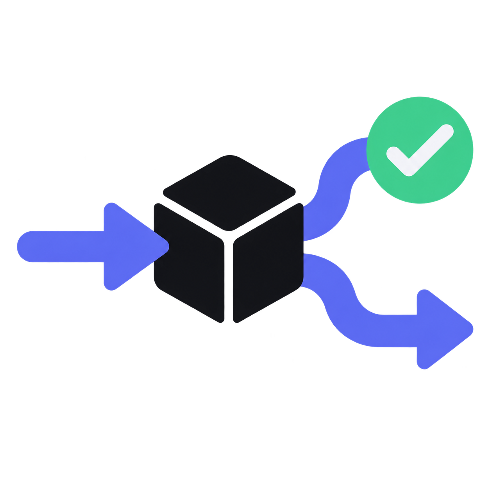
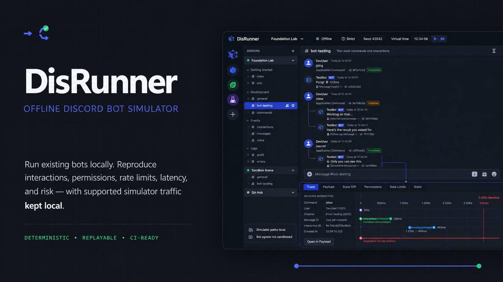

# DisRunner

<p align="center">
  
</p>

<p align="center">
  <strong>Run and test Discord bots locally, without a live Discord connection.</strong>
</p>

<p align="center">
  <a href="https://github.com/YanagiKH/DisRunner/actions/workflows/ci.yml"></a>
  <a href="https://github.com/YanagiKH/DisRunner/actions/workflows/security.yml"></a>
  <a href="https://github.com/YanagiKH/DisRunner/releases"></a>
  <a href="LICENSE"></a>
</p>

> [!IMPORTANT]
> **v1.0 supports raw interaction webhooks, discord.js 14.27.0, and discord.py 2.6.4.** Prepare your Bot dependencies first, then run with synthetic credentials and local REST/Gateway endpoints. The supported Discord API v10 profile is documented in [Compatibility](COMPATIBILITY.md).

DisRunner connects a local Bot process to an interactive desktop and a headless scenario runner. Create and save test fixtures, invoke commands and components, inspect actual responses, inject bounded faults, and use the same scenarios in CI. Core model tests retain virtual time and deterministic replay; real Bot runs use wall time and actual handlers.



DisRunner is independent software and is not affiliated with, endorsed by, or sponsored by Discord Inc. Discord is a trademark of Discord Inc. The project does not include Discord logos or proprietary client assets.

## What works in v1.0

- **Core library:** versioned state, seeded IDs/randomness, virtual time, snapshots, interaction lifecycle rules, permission and intent checks, rate limits, REST/Gateway transports, traces, assertions, and risk findings.
- **CLI:** validate and run model scenarios or real Bot scenarios; cancel safely; record/replay model runs; export JSON, JUnit, HTML, SARIF, and redacted reproduction bundles.
- **Bot integrations:** authenticated raw webhooks, pinned discord.js and discord.py adapters, genuine SDK cache/command synchronization, and local attachment upload/download.
- **Desktop:** select/start/stop/restart projects, send messages and typed commands, operate buttons/selects/modals, switch actor views, and inspect live state and diagnostics.
- **Saved workspaces:** edit fixtures and scenarios with undo/redo, atomic saves, backups, conflict detection, explicit recovery, and version checks.

The following remain outside the v1.0 profile:

- arbitrary SDK versions or a generic Gateway/stdio adapter;
- complete Components V2, voice, presence, reactions, advanced threads/forums, or Discord CDN simulation;
- multi-Bot/sharded execution or arbitrary Bot memory checkpoints;
- automatic dependency installation, automatic updates, or advanced CPU/event-loop profiling;
- complete Discord route/client parity or an OS sandbox for imported code.

See [Compatibility](COMPATIBILITY.md) for the support boundary.

## Environment targets

Source development requires Node.js `>=22.23.2 <23` and pnpm `11.19.0`.

| Target              | Installer                |
| ------------------- | ------------------------ |
| Windows 11 x64      | Signed NSIS installer    |
| macOS 14+ arm64/x64 | Signed and notarized DMG |
| Ubuntu 24.04+ x64   | AppImage                 |

Download artifacts and their checksums/provenance from [Releases](https://github.com/YanagiKH/DisRunner/releases). Each release includes platform installation receipts; hosted CI operating systems and minimum OS targets are listed separately in [Installation](docs/installation.md).

| Bot integration         | v1.0 profile     | Notes                                                                      |
| ----------------------- | ---------------- | -------------------------------------------------------------------------- |
| Raw interaction webhook | Supported        | Bundled Node example, Ed25519 requests and per-run response authentication |
| `discord.js`            | 14.27.0          | Node 22; ESM and CommonJS entry points                                     |
| `discord.py`            | 2.6.4            | Python 3.12; explicit interpreter or activated environment                 |
| Generic Gateway/stdio   | Unsupported      | Use a supported adapter                                                    |
| Simulator SDK           | Core/runtime API | Included in the offline CLI distribution                                   |

## Quick start

```bash
git clone https://github.com/YanagiKH/DisRunner.git
cd DisRunner
corepack enable
corepack prepare pnpm@11.19.0 --activate
pnpm install --frozen-lockfile
pnpm run verify
```

Run a deterministic core scenario or a real Bot scenario:

```bash
pnpm run cli -- run scenarios/interaction-lifecycle.discord-scenario.yml --seed 42
pnpm run cli -- report scenarios/interaction-lifecycle.discord-scenario.yml --format json --out disrunner-report.json
pnpm run cli -- test scenarios/v2/raw-ping.json
pnpm run cli -- repro scenarios/v2/raw-ping.json --out reproduction.json
```

Record and verify a replay:

```bash
pnpm run cli -- record scenarios/interaction-lifecycle.discord-scenario.yml --out recording.json --seed 42
pnpm run cli -- replay recording.json --out verification.json
```

Start the desktop:

```bash
pnpm run dev
```

In **Settings → Runtime paths**, open the bundled example or choose your own configured project, start the Bot, and invoke `/ping`. The bundled example is copied to an editable local project. The browser renderer started by `pnpm run dev:web` is a labeled demo and cannot manage Bot processes.

Read [Installation](docs/installation.md), [Getting started](docs/getting-started.md), and [Project configuration](docs/project-configuration.md) for the exact workflow.

## Offline boundary

DisRunner's own supported protocol path uses loopback endpoints, synthetic credentials, a per-run raw-webhook response key, and no live Discord token. Ed25519 authenticates requests to the bot; HMAC-SHA-256 authenticates the HTTP status and exact response bytes back to the supervisor before JSON parsing. The compatibility-layer network helper rejects Discord destinations and supported logs/reports are redacted.

This is an application-level boundary, **not an operating-system sandbox for an imported bot**. A bot, dependency, install script, native module, or child process can open its own network connection. Run untrusted code only inside the documented [hard-isolation setup](docs/offline-mode.md#hard-isolation), and never provide a production token.

## Architecture

```text
Desktop / CLI / Scenario v2
           │
           └──> shared Session ──> authoritative state and diagnostics
                       │
                       └──> local REST / Gateway / signed webhook
                                         │
                                         └──> real Bot process

Model scenarios ──> virtual clock + core ──> deterministic recording/replay
```

Desktop and CLI use the same project loader, process lifecycle, transports, and result policy. Mutations update one state model; private replies and DMs remain bound to the selected actor. Unknown routes and unsupported profiles fail explicitly.

Existing raw projects retain their documented legacy permission profile unless they enable [ordinary-message enforcement](docs/project-configuration.md#ordinary-message-permission-opt-in). SDK projects enable the supported guild-text permission profile by default.

## Limits

- Discord can change independently of this project.
- The current REST and Gateway catalogs are partial.
- Real Bot runs use actual process time; virtual time does not control arbitrary host timers or external services.
- Faults are scoped and bounded; dropped/truncated evidence is reported and cannot produce a passing CI result.
- Voice transport, encryption, audio, CDN behavior, regional routing, anti-abuse systems, and undocumented desktop behavior are out of scope.
- Simulation reduces risk; it cannot guarantee production correctness or absence of vulnerabilities.

See [Known limitations](docs/limitations.md) and [Protocol compatibility](docs/protocol-compatibility.md).

## Documentation

- [Installation](docs/installation.md) · [Getting started](docs/getting-started.md) · [Project configuration](docs/project-configuration.md)
- [Interface tour](docs/ui-tour.md) · [Architecture](docs/architecture.md) · [Known limitations](docs/limitations.md)
- [Offline mode](docs/offline-mode.md) · [Security model](docs/security-model.md) · [Threat model](docs/threat-model.md) · [Privacy](docs/privacy.md)
- [Gateway](docs/gateway-emulator.md) · [REST](docs/rest-emulator.md) · [Interactions](docs/interaction-engine.md)
- [Permissions](docs/permission-engine.md) · [Rate limits](docs/rate-limit-engine.md) · [Fault injection status](docs/fault-injection.md)
- [Scenarios](docs/scenario-format.md) · [Assertions](docs/assertions.md) · [Tracing](docs/trace-system.md) · [Risk rules](docs/risk-engine.md)
- [Debugging](docs/debugging.md) · [Troubleshooting](docs/troubleshooting.md) · [Release process](docs/release-process.md)

## Project status

DisRunner follows semantic versioning. Versioned project/workspace/scenario formats preserve documented compatibility; only fields and behavior explicitly listed in [Compatibility](COMPATIBILITY.md) are commitments. Follow the [roadmap](ROADMAP.md) and [changelog](CHANGELOG.md), and pin CI to a known release.

Read [CONTRIBUTING.md](CONTRIBUTING.md) before contributing. Report security issues according to [SECURITY.md](SECURITY.md). DisRunner is available under the [MIT License](LICENSE).
