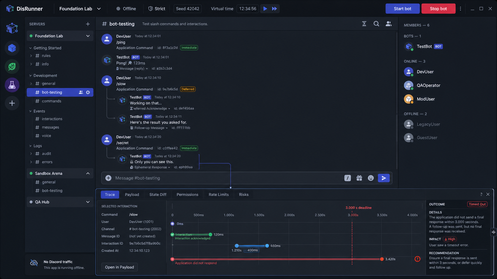
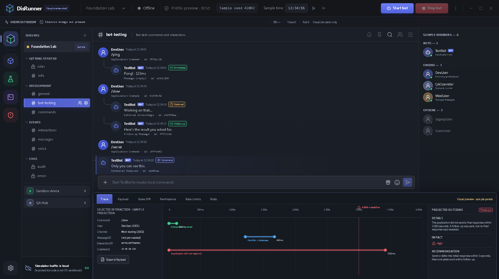

# Interface tour

Desktop presents the selected project's live session. Browser-only development uses an explicitly separate demo and cannot start local processes.

This image is a design concept. The historical renderer snapshot below is a visual reference; the running application obtains its project data through the shared runtime.

## Project workflow

| Surface                  | Current behavior                                                                                              |
| ------------------------ | ------------------------------------------------------------------------------------------------------------- |
| Settings                 | Open/browse a project; inspect adapter/launch details; edit saved seed/mode; reload or restore workspace data |
| Runtime strip            | Start/stop, phase, PID, errors, and bounded process output                                                    |
| Guild/channel navigation | Loaded fixture/workspace guilds, channels, and actors; explicit DM contexts                                   |
| Conversation             | Retained messages for the selected context; supported embeds, local attachments, and components               |
| Command Explorer         | Current local command registry, typed options/subcommand paths, context targets, invocation and autocomplete  |
| Guild Editor             | Validated resource JSON, bounded Undo/Redo, save and reload                                                   |
| Scenario Lab             | JSON/YAML source editing, validation, saved cases, fresh-session run/cancel, four-format export               |
| Inspector                | Available current trace, message, and invocation information                                                  |
| Risk Center              | Findings and process output recorded for the current run                                                      |

## Commands, components, and visibility

Start the Bot before invoking a command. SDK commands are registered locally through the actual SDK; the raw example's handler also accepts its documented commands. Typed command forms come from registered definitions.

Buttons and selects operate on their actual source message. Disabled controls do not dispatch; link buttons do not become interactions. Modal submission sends the entered fields, while cancellation sends nothing. User input is bound to the selected actor/channel when sent, so navigation does not move a delayed response into another channel.

Public snapshots omit ephemeral responses. The selected actor's view includes its own private responses with a visibility label. A different actor does not receive those messages through a guild broadcast.

## Save and run

Stop the Bot before saving fixture changes. Unsaved changes are indicated in the editor, and invalid resource relationships show an error. A conflicting external edit is reported instead of overwritten. Scenario Lab starts a fresh session from saved project resources and preserves the final report after cleanup.

Report exports use JSON, JUnit, HTML, or SARIF. The report identifies real Bot execution, result, run context, completeness, and faults. Risk baselines, trends, and expiring suppressions are outside the current interface.

## Keyboard and status

Primary controls use native focusable elements and accessible labels. Loading, empty, invalid, busy, and cancelled states have text in addition to color. A complete screen-reader, localization, high-DPI, and contrast audit is separate from these implemented controls.

All bundled identities and content are synthetic. See [Workspaces](workspaces.md), [SDK adapters](sdk-adapters.md), and [Getting started](getting-started.md) for the complete workflow.
